 

<picture><source media="(prefers-color-scheme: dark)" srcset="assets/h1-dark.svg"><source media="(prefers-color-scheme: light)" srcset="assets/h1-light.svg"></picture>

Since 2017 I have been fixing the technical side of marketplace product data: flat file errors, broken parent/child variations, suppressed listings and catalogs stuck in spreadsheets. Now I am turning that work into software, so the repetitive parts of catalog management run as tools instead of manual Excel work.

- **Catalog consulting** for sellers and brands on Amazon, eBay, Shopify and other marketplaces
- **Automation** for bulk uploads, data mapping, migrations and catalog cleanup
- **Seller tools** built from problems I have solved by hand again and again

 

<picture><source media="(prefers-color-scheme: dark)" srcset="assets/h2-dark.svg"><source media="(prefers-color-scheme: light)" srcset="assets/h2-light.svg"></picture>

 

<picture><source media="(prefers-color-scheme: dark)" srcset="assets/h3-dark.svg"><source media="(prefers-color-scheme: light)" srcset="assets/h3-light.svg"></picture>

Most of this is still private while it is in development. Public releases will be pinned here as they ship.

 

<picture><source media="(prefers-color-scheme: dark)" srcset="assets/h4-dark.svg"><source media="(prefers-color-scheme: light)" srcset="assets/h4-light.svg"></picture>

 

<picture><source media="(prefers-color-scheme: dark)" srcset="assets/h5-dark.svg"><source media="(prefers-color-scheme: light)" srcset="assets/h5-light.svg"></picture>

Computer Science graduate (BS and MCS) with an interest in applied machine learning. Co-author of *Machine Learning Prediction of Student Academic Performance Based on Educational and Lifestyle Factors* (Annual Methodological Archive Research Review, 2025).

 

**[hasnain360.com](https://hasnain360.com/)** &nbsp;·&nbsp; [LinkedIn](https://www.linkedin.com/in/hasnukhan/) &nbsp;·&nbsp; [Fiverr](https://www.fiverr.com/hasnain360) &nbsp;·&nbsp; [Upwork](https://www.upwork.com/freelancers/~0135bece5a402d567c)

Open to catalog consulting and automation projects.

